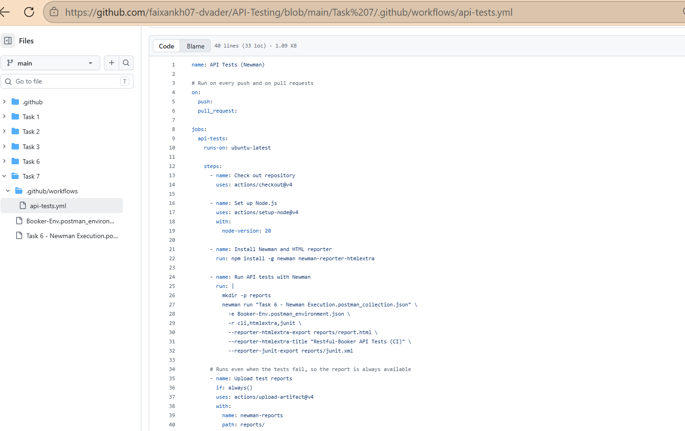
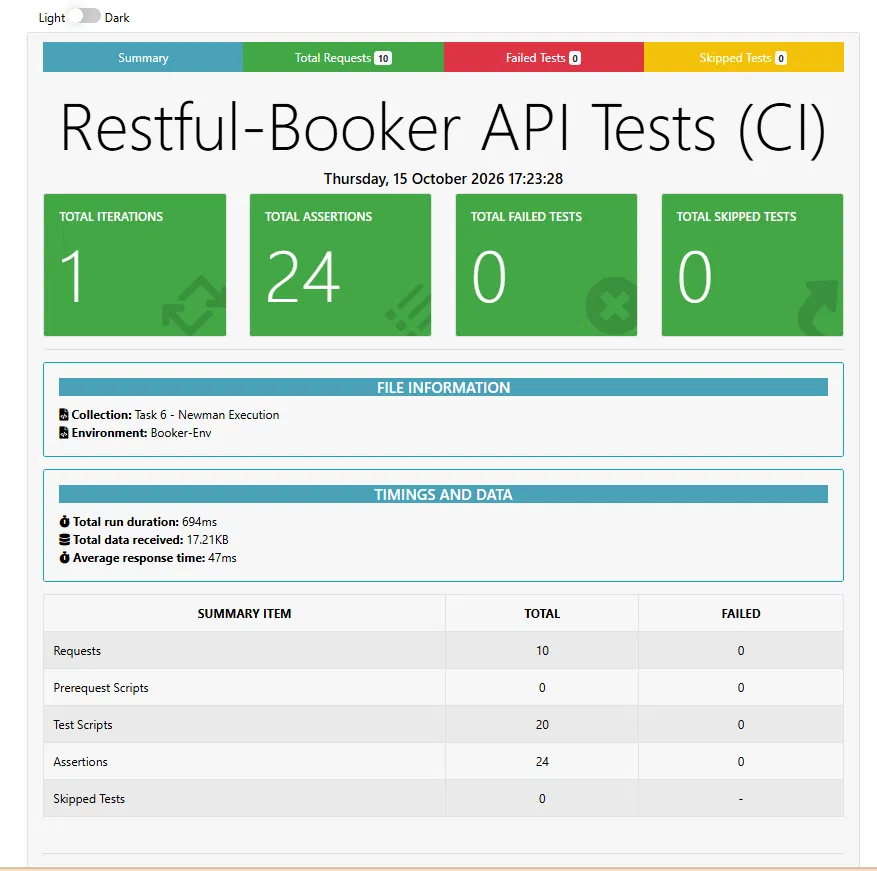
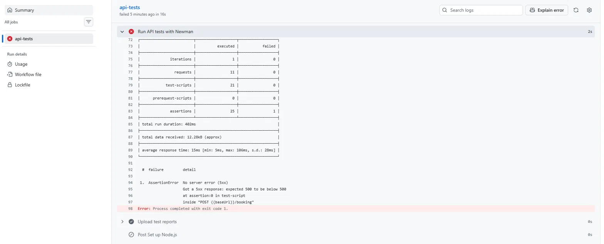
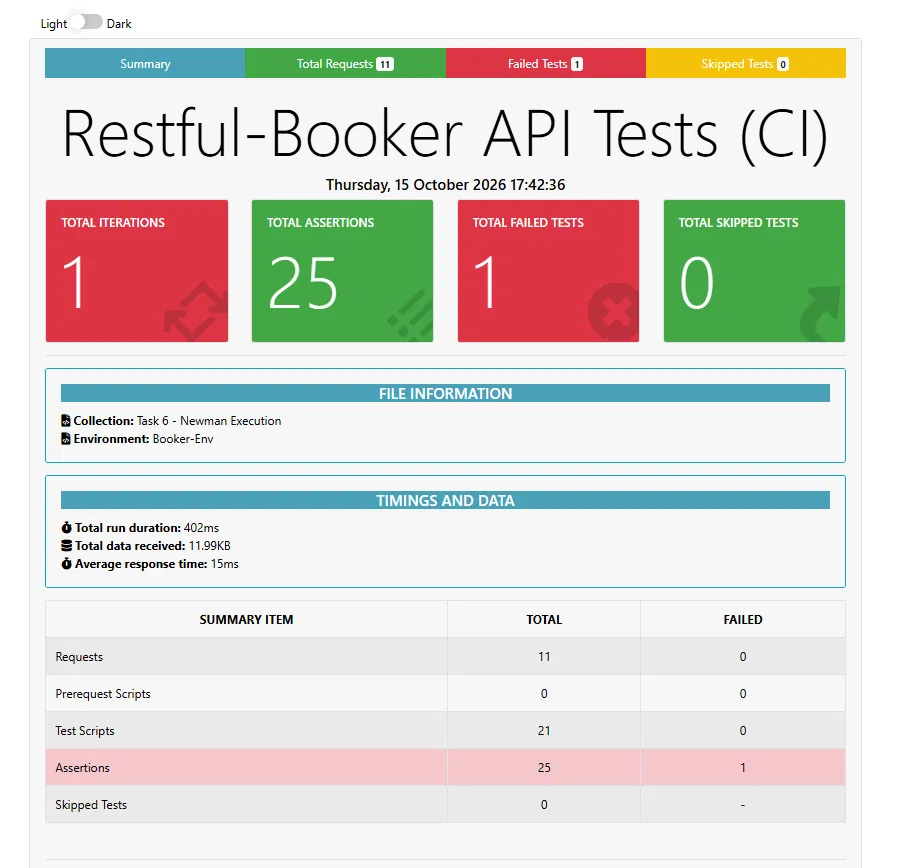
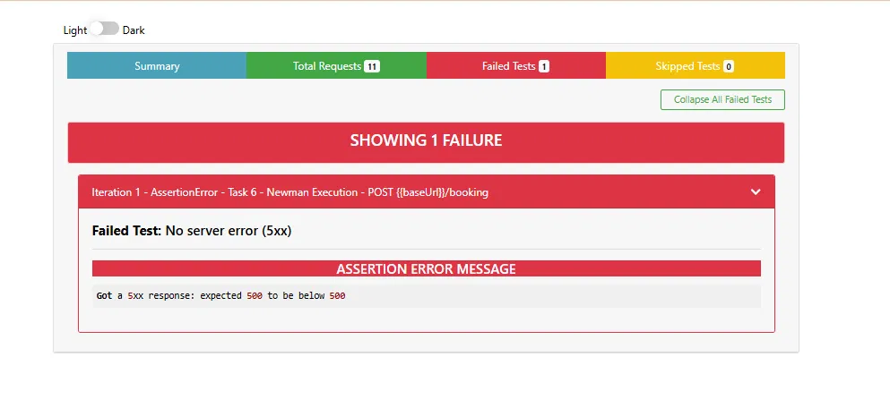

# Task 7: CI/CD Pipeline Integration (GitHub Actions + Newman)

Part of the Barakah TechLabs **API Testing Specialist** internship (QA & Testing).

A GitHub Actions workflow that runs the Postman/Newman API test suite on **every push** and **fails the build if any endpoint returns a 5xx server error**. The suite is the 10-request Restful-Booker collection from Task 6.

## How it works

1. On every push (and pull request), GitHub starts an Ubuntu runner.
2. The workflow installs Node.js, Newman and the htmlextra reporter.
3. Newman runs the exported collection with the exported environment from the `Task 7` folder.
4. Newman exits with a non-zero code if any assertion fails, which makes the job fail and the build go red.
5. The HTML and JUnit reports are uploaded as a downloadable artifact, even when the tests fail.

### The 5xx gate

A collection-level test script runs after **every** request in the collection, so any server error fails the build no matter which endpoint caused it:

```javascript
pm.test("No server error (5xx)", () => {
  pm.expect(pm.response.code, "Got a 5xx response").to.be.below(500);
});
```

This adds one assertion per request on top of each request's own tests (10 requests give 14 + 10 = 24 assertions).

## Results

| Run | Branch | Requests | Assertions | Failed | Result |
|---|---|---|---|---|---|
| Normal suite | `main` | 10 | 24 | 0 | Build passes |
| Demo failure | `demo-failure` | 11 | 25 | 1 | Build fails (exit code 1) |

### Proof that the gate works

To check that the pipeline really fails on a server error, I pushed a branch (`demo-failure`) with one extra request: a `POST /booking` with an **empty body**, which makes Restful-Booker return `500 Internal Server Error`.

- The collection-level test failed with: *Got a 5xx response: expected 500 to be below 500*.
- Newman finished with `Process completed with exit code 1`, and the workflow run turned red.
- The **Upload test reports** step still ran, so the HTML report with the failure was available as an artifact.

The demo branch was deleted afterwards, so `main` stays green.

## Screenshots

### 1. The workflow file
The GitHub Actions workflow at `.github/workflows/api-tests.yml`.



### 2. Green run on `main`
Run 3: every step of the job passed, including the Newman run and the report upload.


The Newman HTML report for that run: 10 requests, 24 assertions, 0 failed.



### 3. Red run on the `demo-failure` branch
Run 4: the workflow run on the branch with the extra empty-body request.


The Newman summary table in the job log: 11 requests, 25 assertions, 1 failed, ending with `Process completed with exit code 1`.



The HTML report summary for the same run: 25 assertions, 1 failed.



The failing test in the report: *No server error (5xx)* failed on the extra `POST /booking` request with *expected 500 to be below 500*.



## Repository layout

This repo holds all of my task folders, so the workflow lives at the **repository root** (GitHub only reads workflows from there) and points into the `Task 7` folder.

```
.
├── .github/
│   └── workflows/
│       └── api-tests.yml
├── Task 7/
│   ├── Task 6 - Newman Execution.postman_collection.json
│   ├── Booker-Env.postman_environment.json
│   ├── README.md
│   └── screenshots/
└── (other task folders)
```

Because the workflow triggers on every push, pushes to other task folders also start a run. That is harmless here, but a larger repo would restrict the trigger with a `paths:` filter.

## Workflow summary (`.github/workflows/api-tests.yml`)

| Step | Purpose |
|---|---|
| Check out repository | Gets the code |
| Set up Node.js (v20) | Required to run Newman |
| Install Newman and HTML reporter | `npm install -g newman newman-reporter-htmlextra` |
| Run API tests with Newman | Runs the collection with `-r cli,htmlextra,junit` and exports the reports |
| Upload test reports (`if: always()`) | Keeps the reports even when the run fails |

The Newman step runs with `working-directory: "Task 7"`, and the upload path is `Task 7/reports/`, because upload paths are relative to the repo root.

## Using GitHub Secrets

The login password is not stored in the repository. It lives in a GitHub Actions secret and is passed to Newman at run time:

1. The secret `BOOKER_PASSWORD` is stored under *Settings → Secrets and variables → Actions*.
2. The login request in the collection uses `{{authPassword}}` in its body, and the exported environment file leaves `authPassword` empty.
3. The workflow maps the secret to an environment variable and hands it to Newman:

```yaml
      - name: Run API tests with Newman
        env:
          BOOKER_PASSWORD: ${{ secrets.BOOKER_PASSWORD }}
        run: |
          newman run "Task 6 - Newman Execution.postman_collection.json" \
            -e Booker-Env.postman_environment.json \
            --env-var "authPassword=$BOOKER_PASSWORD" \
            ...
```

GitHub masks the value as `***` in the job log. Restful-Booker's admin password is public demo data, so this shows the mechanism and does not protect a real credential.

## Run it locally

```
npm install -g newman newman-reporter-htmlextra
cd "Task 7"
newman run "Task 6 - Newman Execution.postman_collection.json" -e Booker-Env.postman_environment.json --env-var "authPassword=password123" -r cli,htmlextra
```

## Problems hit and fixed

| Problem | Cause | Fix |
|---|---|---|
| Workflow never started | `.github/workflows` was inside `Task 7`, not at the repo root | Created the workflow at the root |
| Run failed with "No event triggers defined in `on`" | The workflow file was committed empty | Pasted the full YAML and committed again |
| Every request failed with `Invalid URI "http:///ping"` | The exported environment had an empty `baseUrl` | Set `baseUrl` in the environment file and pushed |
| Login returned no token, so `PUT` and `DELETE` returned 403 and the final `GET` returned 200 instead of 404 | The workflow had not yet been updated to pass the `BOOKER_PASSWORD` secret to Newman | Updated the Newman step to pass `authPassword` from the secret |

## Notes and limitations

- **Secrets are masked in logs, not in uploaded files.** The HTML report is uploaded as an artifact and can show request bodies, so a real credential could appear there. A project with real keys would also need to hide sensitive data in the report.
- The workflow only gates on assertions and 5xx responses. It does not enforce response-time limits.
- The suite runs against a shared public server, so an occasional slow or failed run can be a server problem and not a code problem. Re-running the job is the first thing to try.
- GitHub shows a notice that the pinned action versions (v4) run on a newer Node runtime. It does not affect the result.

## Tools

GitHub Actions, Newman, newman-reporter-htmlextra, Postman, JavaScript (Chai assertions)

## Author

**M Faizan Khan**
GitHub: [faixankh07-dvader](https://github.com/faixankh07-dvader)
